# AutoFix: gestión de órdenes de reparación automotriz

Plataforma para un centro de servicio automotriz: recepción de vehículos, diagnóstico, presupuestos, asignación de mecánicos, inventario de repuestos con control de concurrencia, fotografías de evidencia y bitácora de auditoría.

La solución tiene dos proyectos separados:

- **AutoFix.Api**: ASP.NET Core Web API (.NET 10) con EF Core + SQLite, JWT, roles, claims, imágenes, concurrencia optimista y middlewares de logs.
- **AutoFix.Mvc**: ASP.NET Core MVC que **solo** consume la API por `HttpClient`. No referencia EF Core ni toca la base de datos.

Además, `herramientas/AutoFix.Pruebas` ejecuta automáticamente las 12 pruebas obligatorias y los dos escenarios de concurrencia.

```
AutoFix.sln
|-- AutoFix.Api/                 Web API (controladores, servicios, EF Core, middlewares)
|-- AutoFix.Mvc/                 MVC (vistas, controladores, HttpClient)
|-- herramientas/AutoFix.Pruebas Pruebas automáticas (consola, Task.WhenAll)
|-- evidencias/                  Capturas y resultado de pruebas
|-- README.md
```

## Requisitos

| Herramienta | Uso |
|---|---|
| SDK de .NET 10 | Compilar y ejecutar (`dotnet --version` debe mostrar 10.x) |
| dotnet-ef | Migraciones: `dotnet tool install --global dotnet-ef` |
| Certificado de desarrollo HTTPS | `dotnet dev-certs https --trust` |
| Git | Clonar y versionar |
| DB Browser for SQLite (opcional) | Ver `AutoFix.Api/autofix.db` |
| Swagger / Postman | Probar la API sin el MVC |

## Instalación

```bash
git clone https://github.com/jojosenthusiast/DAW_Carlos_Murgas_Laboratorio2_TercerPeriodo.git
cd DAW_Carlos_Murgas_Laboratorio2_TercerPeriodo
dotnet restore
dotnet build AutoFix.sln
dotnet dev-certs https --trust
```

### Llave JWT (no se guarda en el repositorio)

```bash
cd AutoFix.Api
dotnet user-secrets set "Jwt:Key" "una-llave-larga-de-al-menos-32-caracteres-para-autofix"
```

Si no la configuras, en Development la API genera una llave temporal al iniciar (los tokens dejan de valer al reiniciarla). En producción la API no arranca sin llave; se puede usar la variable de entorno `Jwt__Key`.

### Base de datos y migraciones

```bash
cd AutoFix.Api
dotnet ef migrations add InicialAutoFix   # solo si la carpeta Migrations no existe
dotnet ef database update
```

La cadena de conexión es `Data Source=autofix.db;Default Timeout=30`. El `Default Timeout` evita el error «database is locked» cuando dos operaciones escriben a la vez. Al iniciar, la API aplica migraciones pendientes y siembra los datos de prueba si la base está vacía.

## Ejecución

En dos terminales:

```bash
dotnet run --project AutoFix.Api --launch-profile https   # https://localhost:7180  (Swagger en /swagger)
dotnet run --project AutoFix.Mvc --launch-profile https   # https://localhost:7280
```

La URL de la API que usa el MVC está en `AutoFix.Mvc/appsettings.json` (`Api:BaseUrl`).

## Usuarios de prueba

| Rol | Correo | Contraseña | Permisos (claims) |
|---|---|---|---|
| Administrador | admin@autofix.com | Admin#2026 | Todos |
| Recepcionista | recepcion@autofix.com | Recepcion#2026 | Ordenes.Crear, Ordenes.Editar |
| Recepcionista (limitado) | recepcion.limitada@autofix.com | Recepcion#2026 | Ordenes.Crear (sin Ordenes.Editar, para demostrar el 403 por claim) |
| Supervisor | supervisor@autofix.com | Supervisor#2026 | Editar, Asignar, Aprobar, Finalizar, Inventario.Gestionar, Reportes.Consultar |
| Supervisor 2 | supervisor2@autofix.com | Supervisor#2026 | Igual que Supervisor (escenario B de concurrencia) |
| Mecánico | mecanico1@autofix.com | Mecanico#2026 | Ordenes.Editar (solo órdenes asignadas) |
| Mecánico | mecanico2@autofix.com | Mecanico#2026 | Ordenes.Editar |
| Cliente | cliente@autofix.com | Cliente#2026 | Solo consulta de sus vehículos, órdenes y presupuestos |

Son datos ficticios para el laboratorio. El registro público (`/Cuenta/Registro` o `POST /api/auth/registro`) crea siempre usuarios con rol Cliente.

## Cómo resuelve los 7 problemas del caso

| # | Problema | Solución |
|---|---|---|
| 1 | Órdenes duplicadas | Validación en el servicio y un índice único parcial en SQLite (`VehiculoId + TipoServicio` cuando la orden no está Entregada ni Cancelada). Responde 409. |
| 2 | Asignación simultánea de mecánicos | Transacción, validación de cruce de horario (`nuevoInicio < finExistente && inicioExistente < nuevoFin`) y cambio del token `Version` del mecánico. |
| 3 | Falta de seguimiento | Máquina de estados validada en el backend, historial de cambios y vista para el rol Cliente. |
| 4 | Sin evidencias | Fotos JPG/PNG de hasta 5 MB, nombre Guid, verificación de la firma real del archivo; en SQLite solo la ruta. |
| 5 | Falta de permisos | JWT + roles + claims (`permiso`) con políticas que combinan ambos. |
| 6 | Inventario sin control | Descuento automático al aprobar el presupuesto, en una transacción, con `CHECK (Existencias >= 0)` en la base. |
| 7 | Sin auditoría | Logs con usuario, endpoint, código, duración, excepción y Correlation ID en archivo y tabla. |

## Concurrencia con SQLite

SQLite no genera `RowVersion`, así que las entidades `Repuesto`, `Mecanico`, `OrdenReparacion` y `Presupuesto` heredan de `EntidadConcurrente`, que tiene un `Guid Version` con `[ConcurrencyCheck]`. `AutoFixDbContext` lo cambia en cada modificación. El cliente puede enviar la `Version` que vio; si ya cambió, la API responde 409. Si dos peticiones chocan dentro del mismo instante, EF Core lanza `DbUpdateConcurrencyException`, que también termina en 409.

- **Escenario A** (`POST /api/repuestos/{id}/salidas` y `POST /api/ordenes/{id}/repuestos`): con 2 unidades y dos pedidos de 2, solo uno se aplica; el otro recibe 409. Nunca queda una existencia negativa.
- **Escenario B** (`POST /api/ordenes/{id}/asignar`): dos supervisores asignan al mismo mecánico en horarios que se cruzan; solo una asignación se guarda y la otra recibe 409.

## Middlewares (en este orden)

1. `CorrelationIdMiddleware`: usa el encabezado `X-Correlation-ID` si es válido o genera uno, y lo devuelve en la respuesta.
2. `ExcepcionesMiddleware`: convierte cualquier excepción en una respuesta JSON clara (`status`, `titulo`, `mensaje`, `correlationId`) sin exponer detalles internos.
3. `RegistroSolicitudesMiddleware`: escribe un log por petición en `AutoFix.Api/Logs/autofix-AAAAMMDD.log` y en la tabla `LogsSolicitudes` (consultable en `GET /api/logs` y en el MVC, Reportes > Bitácora).
4. Autenticación, 5. Autorización, 6. Controladores.

El MVC envía su propio Correlation ID en cada llamada, así que una acción de la interfaz se puede seguir de punta a punta.

## Endpoints principales

| Método | Ruta | Acceso |
|---|---|---|
| POST | /api/auth/login, /api/auth/registro | Público |
| GET | /api/auth/perfil | Autenticado |
| CRUD | /api/usuarios (permisos y estado) | Administrador |
| CRUD | /api/clientes, /api/vehiculos (+ `/foto`) | Lectura: personal. Escritura: Administrador y Recepcionista |
| GET/POST/PUT | /api/ordenes | Crear: `Ordenes.Crear`. Editar: `Ordenes.Editar` |
| PATCH | /api/ordenes/{id}/estado | `Ordenes.Editar` + reglas por estado |
| POST | /api/ordenes/{id}/asignar | Supervisor + `Ordenes.Asignar` |
| POST | /api/ordenes/{id}/finalizar | Supervisor + `Ordenes.Finalizar` |
| POST | /api/ordenes/{id}/presupuesto, /api/presupuestos/{id}/enviar | `Ordenes.Editar` |
| POST | /api/presupuestos/{id}/aprobar, /rechazar | Supervisor + `Ordenes.Aprobar` |
| POST | /api/ordenes/{id}/evidencias | Personal del taller (multipart/form-data) |
| CRUD | /api/repuestos (+ `/entradas`, `/salidas`, `/foto`) | Escritura: `Inventario.Gestionar` |
| GET | /api/movimientos, /api/repuestos/alertas | Personal |
| GET | /api/reportes/*, /api/logs | `Reportes.Consultar` (el dashboard es para todos) |

Todas las peticiones de ejemplo están en `AutoFix.Api/AutoFix.Api.http`.

## Pruebas obligatorias

Con la API en ejecución:

```bash
dotnet run --project herramientas/AutoFix.Pruebas -- todo https://localhost:7180/ | tee evidencias/resultado-pruebas.txt
```

Comprueba las 12 pruebas del enunciado y validaciones adicionales (orden duplicada, archivos falsos, saltos de estado, flujo completo hasta Entregado). Devuelve código 0 si todo pasa. Se puede ejecutar solo una parte con `humo` o `concurrencia`.

| # | Demostración | Evidencia |
|---|---|---|
| 1 | Cliente con dos vehículos | 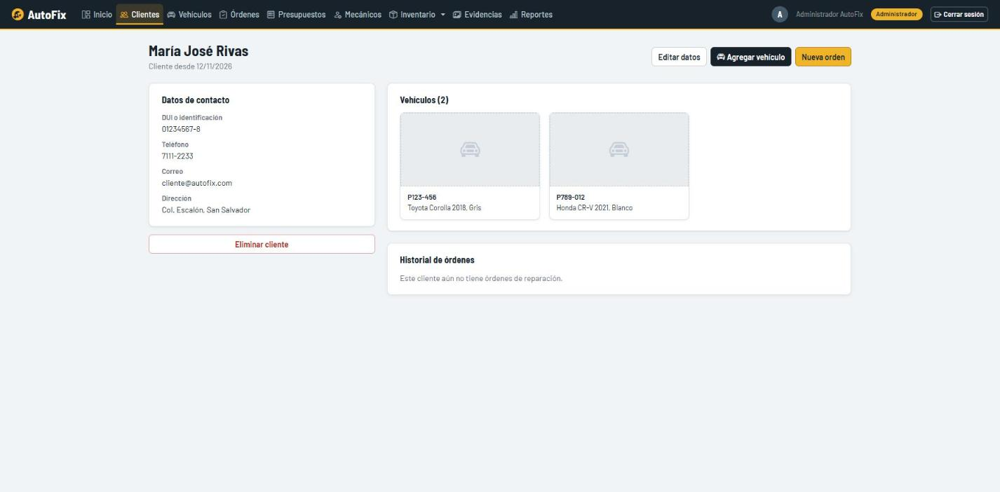 |
| 2 | Orden en estado Recibido | 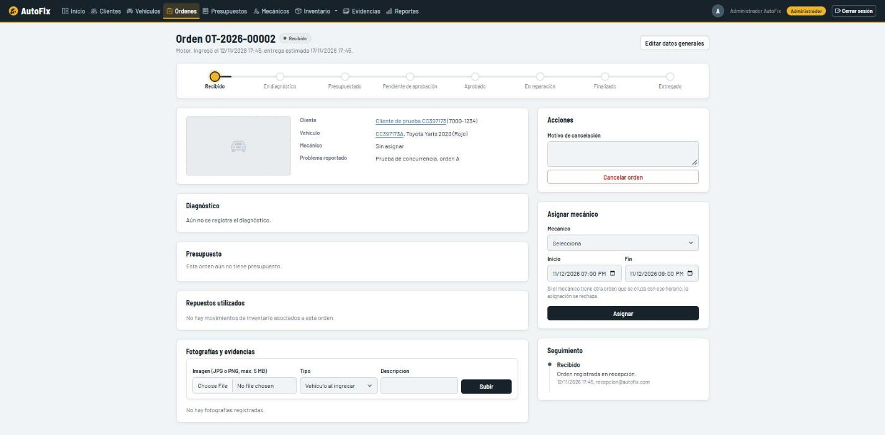 |
| 3 | Mecánico asignado | 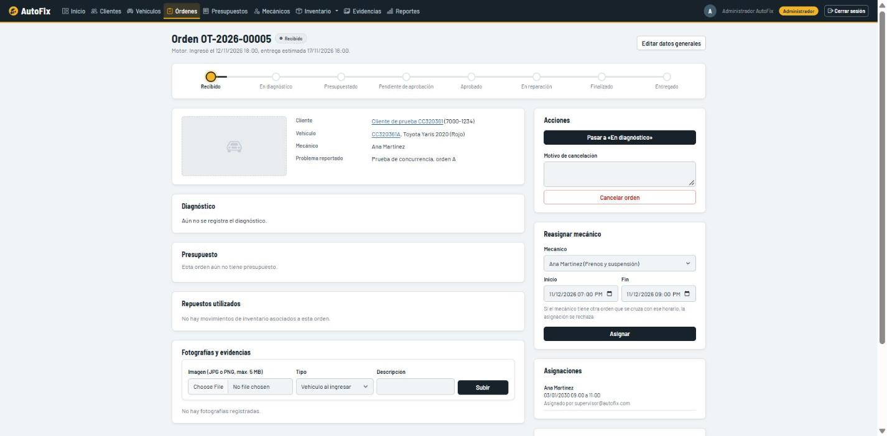 |
| 4 | Modificar sin permisos: 403 | 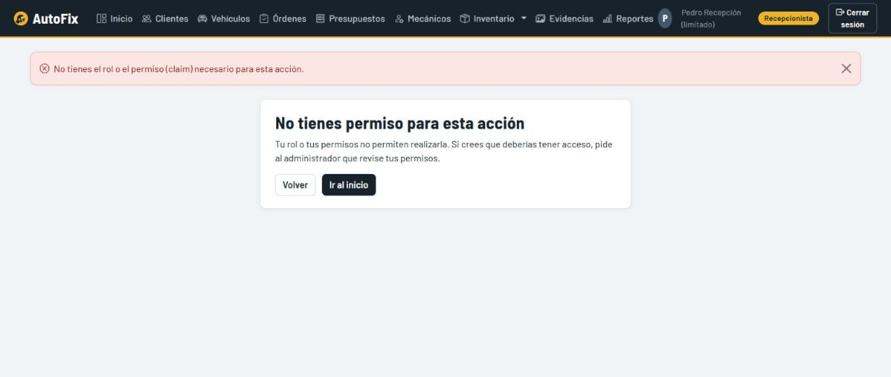 |
| 5 | Presupuesto con subtotales y total | 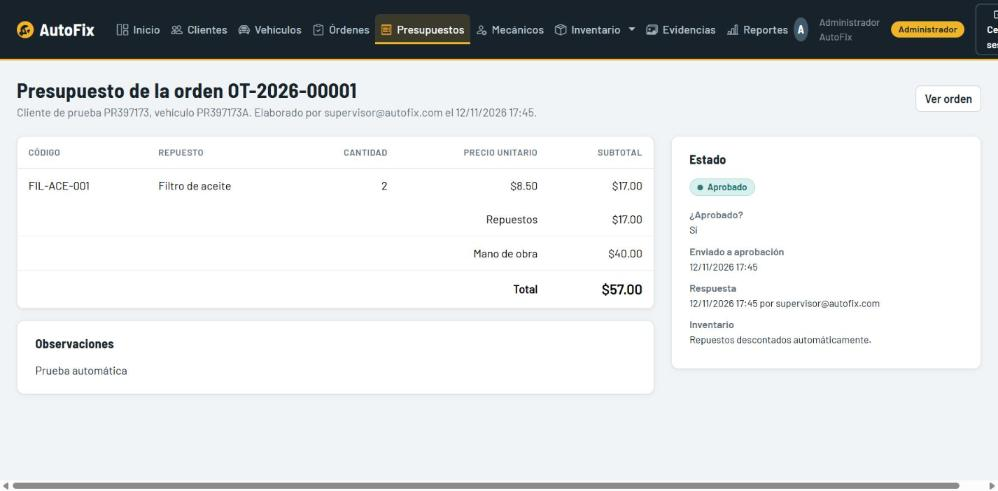 |
| 6 | Presupuesto aprobado | 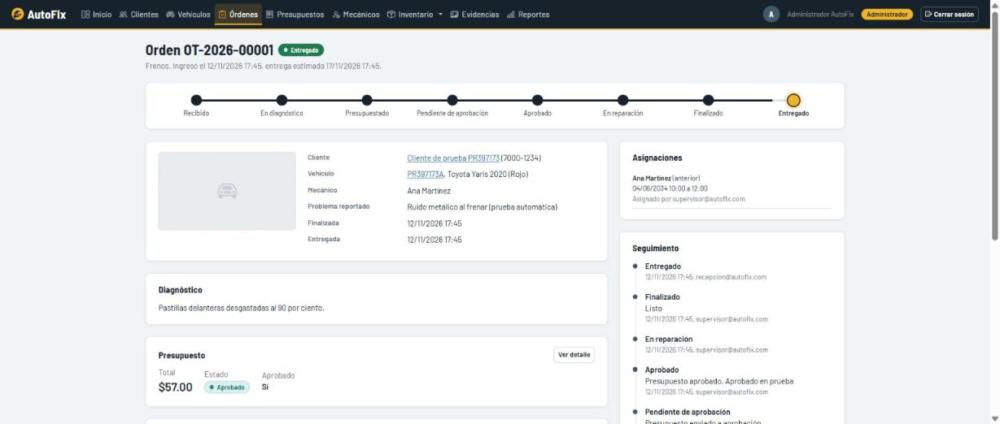 |
| 7 | Fotografías y rutas en la base | 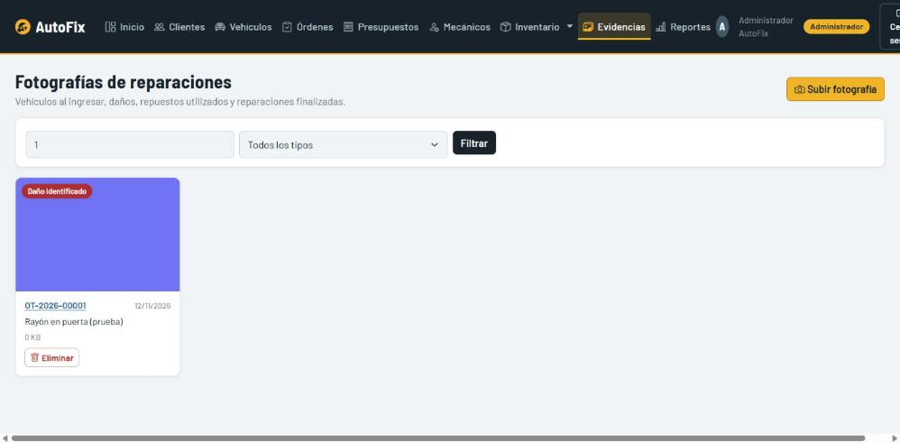 |
| 8 | Descuento de inventario + movimiento | 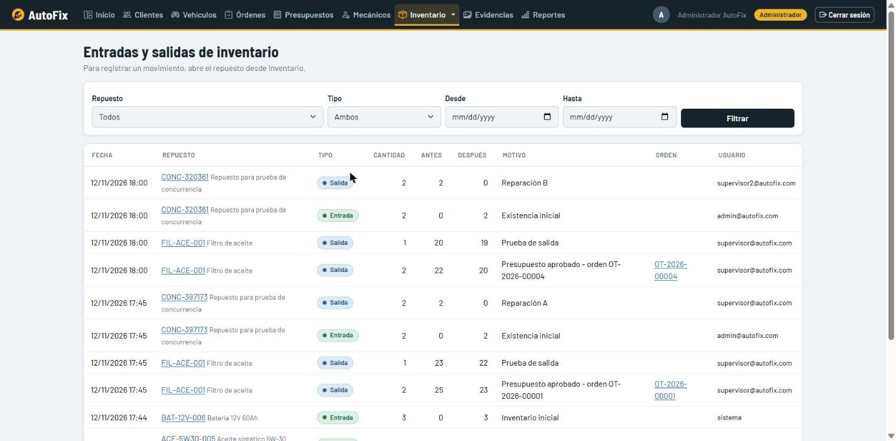 |
| 9 | Existencias insuficientes | 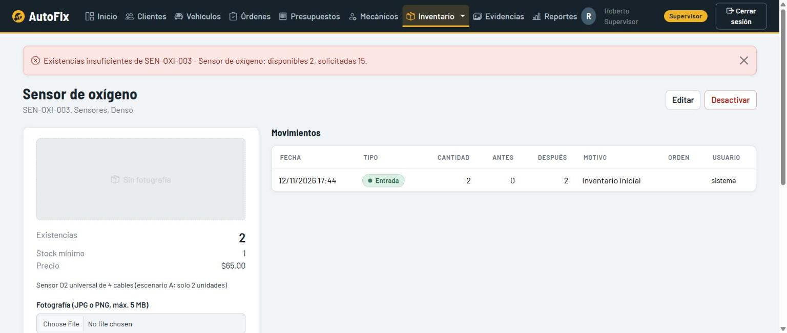 |
| 10 | Concurrencia: 200 y 409 |  |
| 11 | Sin JWT: 401 | 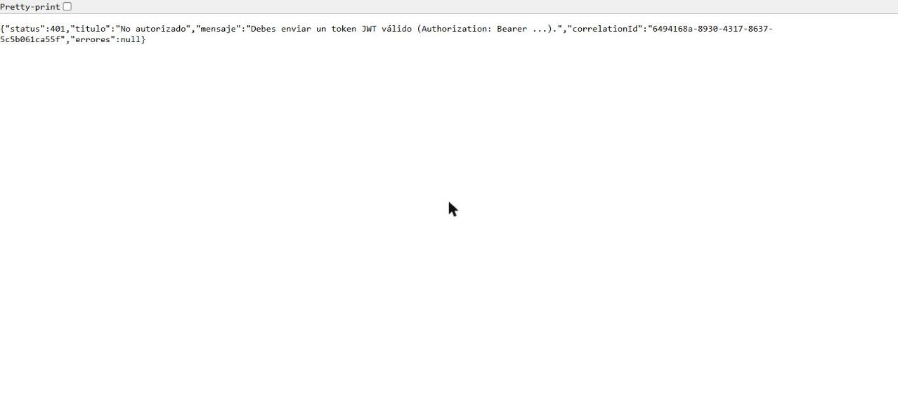 |
| 12 | Log con Correlation ID | 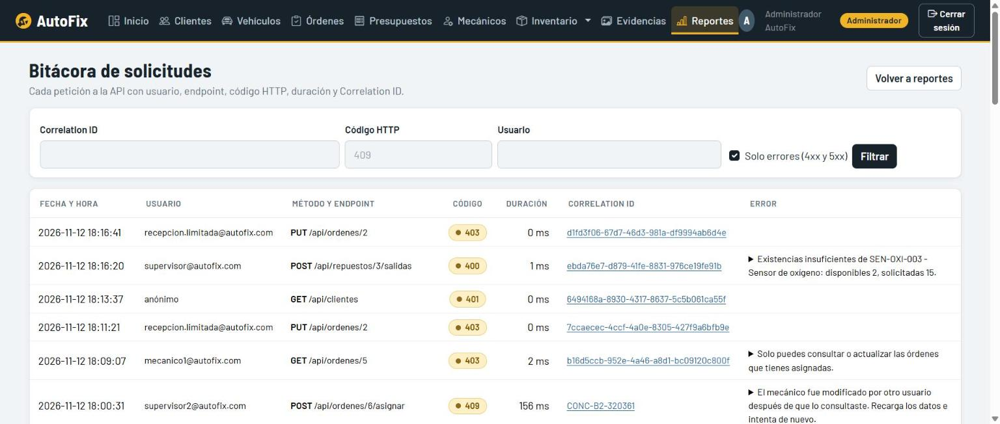 |

## Vistas del MVC

Login (y registro de clientes), Dashboard, Clientes, Vehículos, Órdenes, Detalle de orden (seguimiento, diagnóstico, estados, asignación, repuestos y fotos), Presupuestos, Mecánicos (asignaciones y disponibilidad), Inventario, Movimientos, Evidencias y Reportes (con bitácora de logs). Cada rol solo ve los botones que le corresponden, pero la seguridad real está en la API.
